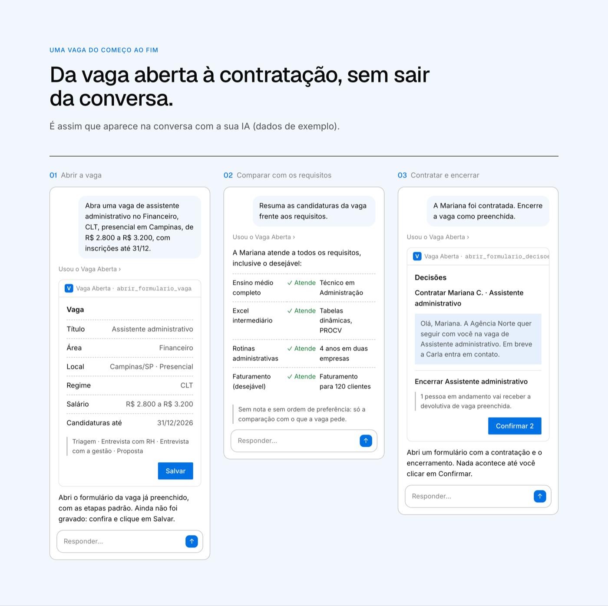
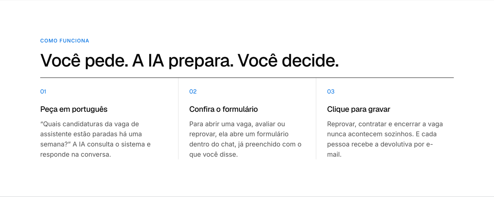
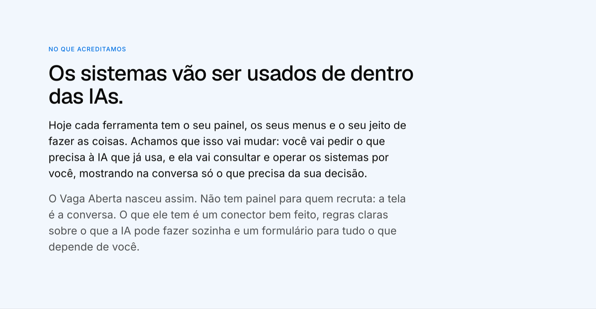
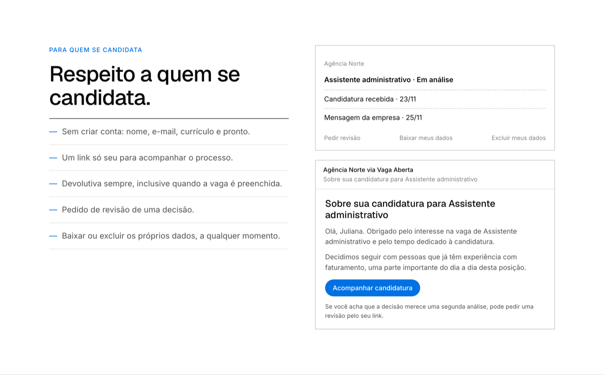
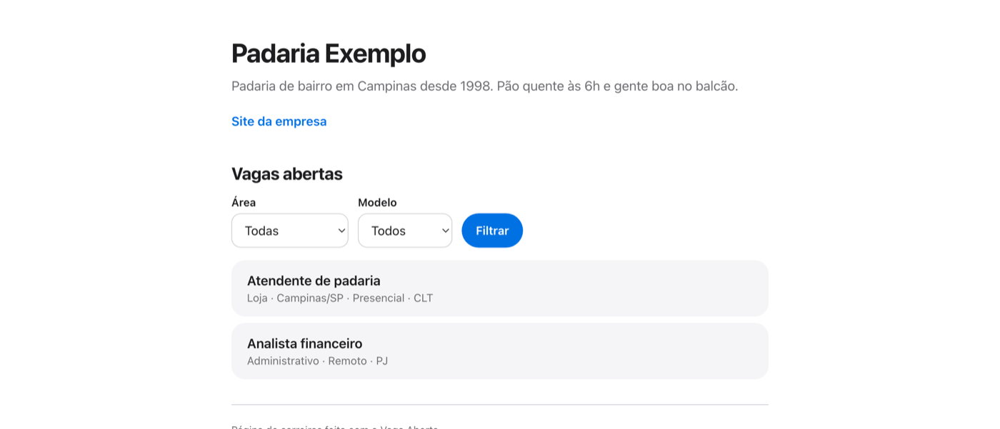
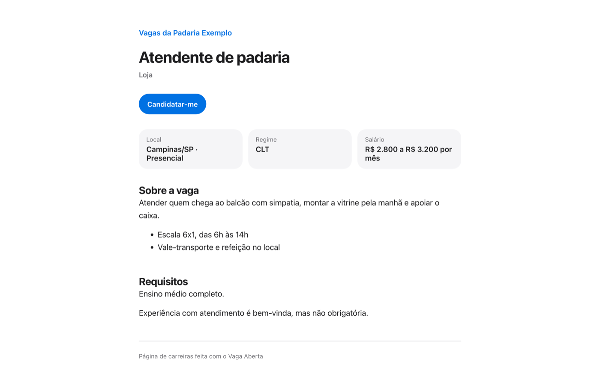
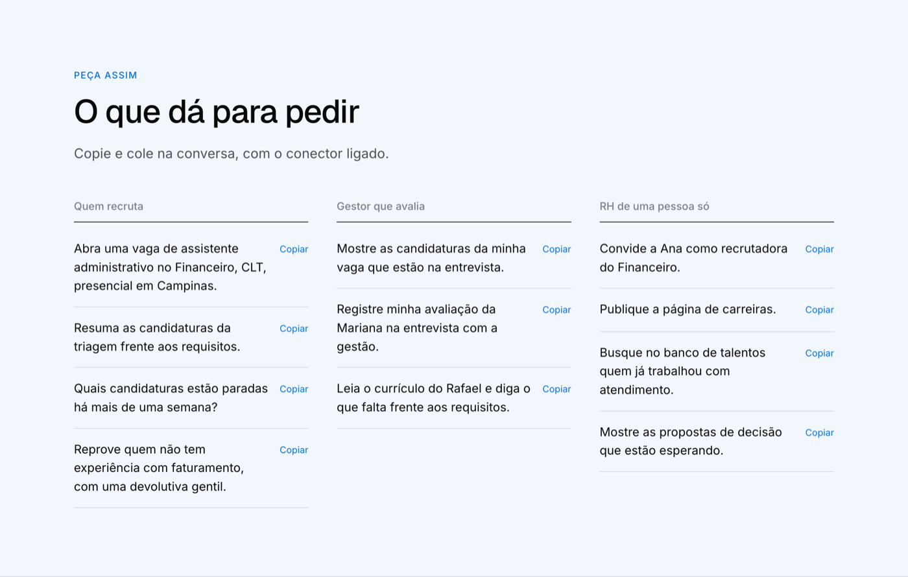
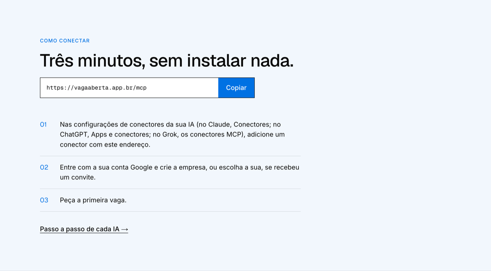

# Vaga Aberta

**Recrutamento e seleção dentro da sua IA.** O Vaga Aberta é um sistema de recrutamento de código aberto e gratuito, sem painel: você abre vagas, lê currículos, avalia e decide conversando com o Claude, o ChatGPT ou o Grok. Quando algo precisa ser gravado, a IA abre um formulário na conversa, já preenchido, e nada acontece sem o seu clique. Candidatos usam páginas web simples (carreiras, candidatura e um link para acompanhar). Para automação, há API REST e webhooks.

**Use agora em [vagaaberta.app.br](https://vagaaberta.app.br)**, sem instalar nada, ou hospede a sua cópia seguindo o passo a passo abaixo.

## Como aparece na conversa com a IA
Você pede em português; a IA consulta o Vaga Aberta e, quando é preciso gravar ou decidir, abre um formulário dentro do chat. Reprovar, contratar e encerrar a vaga só acontecem com o clique de alguém da equipe, e cada pessoa recebe a devolutiva por e-mail. As telas abaixo usam dados de exemplo.





## No que acreditamos


## Para quem se candidata
Sem criar conta, com um link só seu para acompanhar, devolutiva sempre, pedido de revisão e os próprios dados para baixar ou excluir.



A página de carreiras de cada empresa e a página da vaga, com os dados estruturados para a busca de vagas do Google:





## O que dá para pedir


## Conectar
O endereço do conector é `https://vagaaberta.app.br/mcp` (ou `{NEXT_PUBLIC_SITE_URL}/mcp` na sua instância). O passo a passo de cada IA está em [vagaaberta.app.br/docs/mcp](https://vagaaberta.app.br/docs/mcp).



## Sobre o projeto
**Clone e use:** cada instância serve uma ou mais empresas, e quem pode criar empresa é a lista `CRIACAO_EMPRESA_EMAILS`; não há cadastro aberto. O nome é **Vaga Aberta** (vagaaberta.app.br, spec 25.1); "contrata" segue só nos nomes internos (repositório, pasta, prefixo `rs_` do banco e cabeçalhos de webhook). Licença [MIT](LICENSE); dependências em [`THIRD_PARTY_NOTICES.md`](THIRD_PARTY_NOTICES.md).

A especificação completa está em [`spec.md`](spec.md); os planos de cada épico, em [`plans/`](plans/); o que existe de fato, em [`DOCUMENTACAO-TECNICA.md`](DOCUMENTACAO-TECNICA.md). O que falta para a entrega (e depende de contas reais) está em [`docs/entrega.md`](docs/entrega.md).

## O que tem
- **Pela conversa (Claude, ChatGPT ou Grok):** vagas (com etapas, perguntas e equipe), página de carreiras com JSON-LD para o Google, funil (listar, buscar, ler currículo, anotar, mover de etapa, exportar CSV), avaliações da equipe, decisões com devolutiva (reprovar, contratar, encerrar a vaga, reabrir), mensagens com modelos, banco de talentos com consentimento, equipe e áreas, chaves de API, webhooks e os dados da empresa.
- **O modelo propõe, a pessoa grava:** cadastros, mensagens e decisões abrem um formulário no chat, já preenchido, que só grava com o clique; mover de etapa e anotar são operações diretas e reversíveis. Decisão sobre uma pessoa só com o clique de alguém da equipe: pela API ou num cliente sem formulários, vira proposta.
- **Para quem se candidata:** candidatura sem conta, link `/c/{token}` para acompanhar, retirar, pedir revisão, baixar e excluir os dados; devolutiva sempre.
- **LGPD:** retenção por empresa com anonimização automática, banco de talentos só com consentimento e prazo, trilha de quem fez o quê, nenhum dado pessoal em log, evento ou webhook.
- **Faxina diária** (`/api/cron/diario`) com alertas ao `ADMIN_EMAIL`, **analytics opcional** sem dado pessoal (eventos `vaga_aberta_*` no Visão do Produto), e as páginas públicas `/`, `/docs/mcp`, `/docs/api`, `/docs/auto-hospedagem`, `/privacidade` e `/termos`.

## Hospedar a sua instância (passo a passo)

Você vai precisar de contas no GitHub, no [Supabase](https://supabase.com), na [Cloudflare](https://dash.cloudflare.com) (R2) ou outro S3, no [Resend](https://resend.com), no [Google Cloud](https://console.cloud.google.com) e na [Vercel](https://vercel.com). Os planos gratuitos servem para começar. Na sua máquina: Node 22 e a [Supabase CLI](https://supabase.com/docs/guides/cli).

### 1. Clonar
```bash
git clone https://github.com/asiqueira1973/contrata.git vaga-aberta
cd vaga-aberta && npm install
```

### 2. Banco (Supabase)
1. Crie um projeto **só para esta instância** (região São Paulo, se os candidatos estão no Brasil).
2. Aplique as migrations da pasta `supabase/migrations`:
   ```bash
   supabase link --project-ref SEU_PROJETO
   supabase db push
   ```
   Todas as tabelas têm o prefixo `rs_`, com RLS ligada e sem política: só o servidor (service role) fala com o banco. O seed (`supabase/seed.sql`, a "Padaria Exemplo") é só para desenvolvimento; não rode em produção.
3. Em **Project Settings → API**, copie a URL para `SUPABASE_URL` e a chave `service_role` para `SUPABASE_SERVICE_ROLE_KEY` (nunca no navegador).

### 3. Armazenamento (Cloudflare R2 ou outro S3)
1. Crie um bucket **privado** (ex.: `vaga-aberta`) e um token de API com leitura e escrita só nesse bucket.
2. Preencha `S3_ENDPOINT` (`https://<conta>.r2.cloudflarestorage.com`), `S3_REGION` (`auto` no R2), `S3_ACCESS_KEY_ID`, `S3_SECRET_ACCESS_KEY` e `S3_BUCKET`.
3. Configure o CORS do bucket: o currículo sobe direto do navegador.
   ```json
   [{ "AllowedOrigins": ["https://SEU_DOMINIO"], "AllowedMethods": ["PUT"], "AllowedHeaders": ["content-type"], "MaxAgeSeconds": 3600 }]
   ```

### 4. E-mail (Resend)
1. Adicione e verifique o domínio do remetente (SPF, DKIM e, de preferência, DMARC). O plano gratuito serve para testar.
2. Crie uma chave de API para `RESEND_API_KEY` e escolha o remetente em `EMAIL_REMETENTE` (ex.: `naoresponda@seudominio.com.br`).

### 5. Login com Google (obrigatório)
O Vaga Aberta só aceita login pelo Google (spec 6.1). No Google Cloud Console:
1. Crie um projeto e configure a tela de consentimento OAuth com os escopos básicos `openid`, `email` e `profile`.
2. Em **Credenciais → Criar credenciais → ID do cliente OAuth**, tipo "Aplicativo da Web".
3. Em **URIs de redirecionamento autorizados**, inclua `https://SEU_DOMINIO/api/auth/google/callback` (em desenvolvimento, `http://localhost:3050/api/auth/google/callback`).
4. Copie o ID e a chave secreta para `GOOGLE_CLIENT_ID` e `GOOGLE_CLIENT_SECRET`.

Quem usa Microsoft 365 pode criar uma conta Google com o mesmo e-mail corporativo (não precisa ser Gmail).

### 6. Vercel
1. Importe o repositório, ponha o seu domínio no projeto e preencha as variáveis da tabela abaixo (em **Production**).
2. Publique. O `vercel.json` já agenda o cron diário (`/api/cron/diario`, 6h de Brasília), que a Vercel chama com `Authorization: Bearer $CRON_SECRET`.
3. Abra `https://SEU_DOMINIO/` e `https://SEU_DOMINIO/docs/mcp` para conferir.

### 7. Primeira empresa
1. Ponha o seu e-mail (ou `@seudominio.com.br`) em `CRIACAO_EMPRESA_EMAILS` e publique de novo.
2. Conecte o conector `https://SEU_DOMINIO/mcp` no Claude ou no ChatGPT (passo a passo abaixo e em `/docs/mcp`). Ao entrar com o Google, crie a empresa na tela de consentimento.
3. Pelo chat: "crie as áreas Financeiro e Loja", "convide a Ana como recrutadora", "abra uma vaga de…" e "publique a página de carreiras".

### 8. Textos legais
As páginas `/privacidade` e `/termos` e o aviso de privacidade da candidatura são **modelos**: preencha `OPERADOR_NOME` e `OPERADOR_CONTATO` com os dados de quem hospeda e revise os textos (em `src/lib/copy.ts`, chaves `legal` e `avisoPrivacidade`) com quem cuida do jurídico. As páginas `/privacidade` e `/termos` são geradas na publicação: depois de mudar essas variáveis, publique de novo.

### Variáveis

| Variável | Obrigatória | Para quê |
|---|---|---|
| `NEXT_PUBLIC_SITE_URL` | sim | Origem pública (`https://SEU_DOMINIO`): OAuth, links dos e-mails, JSON-LD, conector |
| `NEXT_PUBLIC_NOME_PRODUTO` | não | Nome exibido (padrão "Vaga Aberta") |
| `SUPABASE_URL` | sim | URL do projeto Supabase |
| `SUPABASE_SERVICE_ROLE_KEY` | sim | Chave service role (só no servidor) |
| `GOOGLE_CLIENT_ID` | sim | Cliente OAuth do Google |
| `GOOGLE_CLIENT_SECRET` | sim | Segredo do cliente OAuth do Google |
| `SESSION_SECRET` | sim | Sessões e HMAC dos códigos e limites públicos. `openssl rand -base64 32` |
| `MCP_PREVIEW_SECRET` | sim | Prévias do conector para clientes sem formulário. `openssl rand -base64 32` |
| `PREVIA_PAGINA_SECRET` | sim | Link de pré-visualização da página de carreiras. `openssl rand -base64 32` |
| `LINK_CANDIDATO_SECRET` | sim | Deriva o link `/c/{token}` do candidato; trocar invalida os links enviados. `openssl rand -base64 32` |
| `S3_ENDPOINT` | sim | Endpoint S3 (R2: `https://<conta>.r2.cloudflarestorage.com`) |
| `S3_REGION` | sim | Região (R2: `auto`) |
| `S3_ACCESS_KEY_ID` | sim | Chave de acesso ao bucket |
| `S3_SECRET_ACCESS_KEY` | sim | Segredo da chave do bucket |
| `S3_BUCKET` | sim | Nome do bucket privado |
| `CRON_SECRET` | sim | Protege `/api/cron/diario`. `openssl rand -base64 32` |
| `CRIACAO_EMPRESA_EMAILS` | sim | E-mails ou `@dominio` que podem criar empresa, separados por vírgula. Vazia, ninguém cria |
| `EMAILS_BLOQUEADOS` | não | E-mails que não entram |
| `ADMIN_EMAIL` | não | Recebe os alertas da instância (login recusado por e-mail em uso, passo da faxina que falhou, banco acima de 70% do plano; um de cada por dia) e é o contato padrão das páginas legais. Vazia, nenhum alerta sai |
| `ALERTA_BANCO_LIMITE_MB` | não | Tamanho do plano do banco em MB, para o alerta de 70% (padrão 500, o plano gratuito do Supabase) |
| `OPERADOR_NOME` | não | Quem opera a instância, no aviso de privacidade e nas páginas legais |
| `OPERADOR_CONTATO` | não | Canal de privacidade (sem ela, o `ADMIN_EMAIL`) |
| `RESEND_API_KEY` | sim | Envio de e-mail. Sem ela, só em desenvolvimento, os e-mails vão para `.caixa-de-saida-local/` |
| `EMAIL_REMETENTE` | sim | Remetente verificado no Resend |
| `CHAVES_ENC_KEY` | sim | Cifra os segredos dos webhooks (32 bytes em base64). `node -e "console.log(require('crypto').randomBytes(32).toString('base64'))"` |
| `VISAO_INGEST_URL` | não | Analytics de produto (Visão do Produto). Sem as duas, nada é enviado |
| `VISAO_API_KEY` | não | Chave do analytics |

## Conectar no Claude, no ChatGPT ou no Grok (detalhes)
O endereço do conector é `{NEXT_PUBLIC_SITE_URL}/mcp` — na instância oficial, `https://vagaaberta.app.br/mcp`. As IAs só alcançam HTTPS público, então a instância precisa estar publicada (ou atrás de um túnel).
- **Claude:** Configurações → Conectores → Adicionar conector personalizado.
- **ChatGPT:** Configurações → Apps e conectores → modo desenvolvedor → criar conector com OAuth.
- **Grok:** nas configurações de conectores, adicione um conector MCP remoto com o endereço. Lá os formulários com botão não aparecem: cadastros saem por prévia na conversa e decisões viram propostas.
- **Claude Code:** `claude mcp add --transport http vaga-aberta https://SEU_DOMINIO/mcp` e, dentro dele, `/mcp` para autenticar.

Ao conectar, você entra com o Google, aceita os Termos, escolhe (ou cria) a empresa e os escopos. Depois é conversar: "quem sou eu?", "convide a Ana como recrutadora da Loja". Cadastros, mensagens e decisões abrem um formulário no chat, já preenchido, que só grava quando você clica; mover de etapa e anotar são diretos. Num cliente sem formulários (como o Claude Code ou o Grok), o agente mostra uma prévia para você confirmar, e decisões viram proposta. Mais exemplos em `/docs/mcp`.

Para automação, crie uma chave de API pelo conector ("crie uma chave de API para o n8n") e use `Authorization: Bearer rsk_…` na API v1 (guia em `/docs/api`, documento em `/api/v1/openapi.json`).

## Rodar localmente

Requisitos: Node 22, Docker, [Supabase CLI](https://supabase.com/docs/guides/cli), `jq`.

```bash
npm install
supabase start            # Supabase local nas portas 557xx; aplica migrations e o seed
cp .env.example .env.local
```

No `.env.local`, `SUPABASE_URL` e `SUPABASE_SERVICE_ROLE_KEY` saem de `supabase status`; os segredos, de `openssl rand -base64 32`. **Sem `S3_*`, os arquivos ficam em `.armazenamento-local/`**, e sem `RESEND_API_KEY`, os e-mails vão para `.caixa-de-saida-local/` (as duas coisas só servem para desenvolvimento).

```bash
npm run dev               # http://localhost:3050
```

### Sem cliente Google, só em desenvolvimento
O seed cria a "Padaria Exemplo" com usuários fictícios. Para entrar como um deles (no consentimento do conector ou num convite):

```bash
node scripts/dev-session.mjs carla@padaria.exemplo
```

O comando imprime um cookie `rs_sessao=…` para colar no navegador em `localhost:3050`. Ele recusa rodar contra um banco que não seja o local.

### Página de carreiras
Com o seed, `http://localhost:3050/padaria-exemplo` mostra a página da Padaria Exemplo com duas vagas publicadas. A página só aparece depois que um administrador a publica (peça ao Claude: "publique a página de carreiras"); antes disso, o formulário devolve um link de pré-visualização que vale 10 minutos.

### Candidatura
Com a página publicada, abra uma vaga e clique em "Candidatar-me". O e-mail com o link de acompanhamento cai em `.caixa-de-saida-local/`; em `/c/{token}` dá para retirar a candidatura, baixar e excluir os dados (o código de exclusão também chega pela caixa local). Quem perdeu o link pede de novo em `/c`.

### Ver os formulários sem o Claude
Com `npm run dev`, abra `http://localhost:3050/dev/formularios`. É um host de MCP Apps que só existe em desenvolvimento: cole um token `rsm_` local, escolha a ferramenta (`abrir_formulario_convite`, `abrir_formulario_avaliacao`…) e os argumentos, e o formulário abre como abriria no chat, em tema claro ou escuro.

### Webhooks
O administrador cria o webhook pelo chat ("crie um webhook para https://…/gancho com candidatura contratada"): o formulário abre, a pessoa confere e confirma, e o segredo `whsec_…` aparece **uma vez**. Cada aviso é um `POST` JSON `{id, tipo, criado_em, empresa_id, dados}` com ids e o resumo da vaga ou da candidatura (sem nome, e-mail ou telefone: busque a pessoa em `GET /api/v1/candidaturas/{id}`), e os cabeçalhos `X-Contrata-Evento`, `X-Contrata-Entrega` e `X-Contrata-Assinatura: t={unix},v1={hex}`. Responda 2xx; senão há nova tentativa em 1 min, 10 min, 1 h e depois uma por dia, por até 3 dias. Só endereços `https` públicos (sem IP interno, sem redirecionamento). Para conferir:

```js
import { createHmac, timingSafeEqual } from "node:crypto";
// corpo: o texto cru da requisição; cabecalho: X-Contrata-Assinatura; segredo: whsec_…
function confere(corpo, cabecalho, segredo) {
  const { t, v1 } = Object.fromEntries(cabecalho.split(",").map((p) => p.split("=")));
  if (Math.abs(Date.now() / 1000 - Number(t)) > 300) return false;
  const esperado = createHmac("sha256", segredo).update(`${t}.${corpo}`).digest("hex");
  return v1.length === esperado.length && timingSafeEqual(Buffer.from(v1), Buffer.from(esperado));
}
```

`CHAVES_ENC_KEY` (32 bytes em base64) cifra os segredos no banco; sem ela, criar webhook falha.

## Testes

```bash
npm run verify            # typecheck, lint, guardrails, pgTAP, Vitest, build e npm audit
```

## Para quem contribui
- As regras de código e as pegadinhas estão em [`CLAUDE.md`](CLAUDE.md); as instruções de revisão, em [`REVIEW.md`](REVIEW.md).
- `./scripts/test-guardrails.sh` testa os hooks de `.claude/hooks/`; `./scripts/check-guardrails-diff.sh` passa o repositório inteiro por eles.
